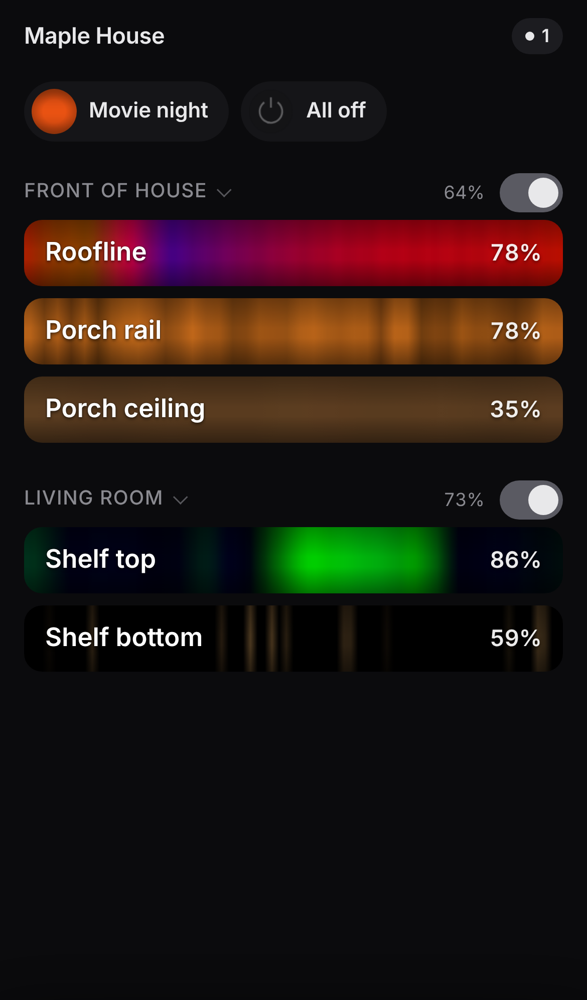
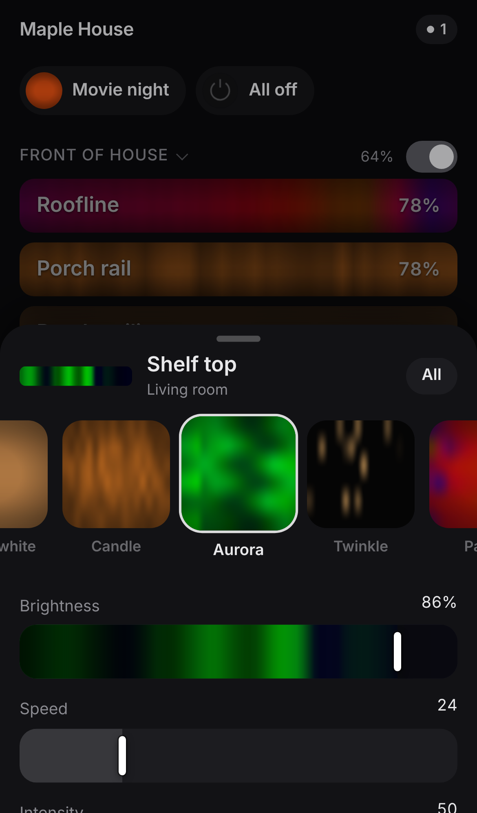
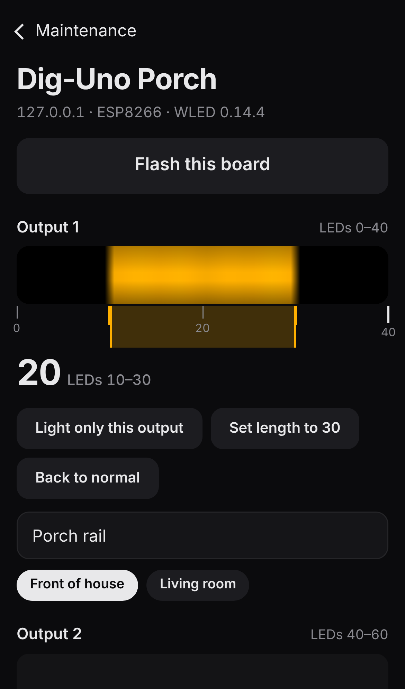

# WLED Fleet

The phone app is **Lumen**: a remote for the light the house is already making. The server behind it (WLED Fleet) keeps a house full of [WLED](https://kno.wled.ge) controllers found, backed up, and on the firmware you chose, out of sight.

Open it and every strip is on screen as a live ribbon of its real pixels, grouped the way you think about the house. Tap a ribbon and paint it: scroll the Look tray and the real lights follow your thumb, lift to keep it. Drag across a ribbon to dim it, flick it to turn it off. There are no boards, tabs, or Refresh buttons on Home. Boards, backups, and firmware live behind one Maintenance screen that only speaks up when something needs you.

<p>



</p>

## How it is organized

Three nouns, all stored on the server:

- **Light**: one WLED segment on one board, the strip you would point at and name ("Porch rail"). A two-output Dig-Uno is two Lights. Power and brightness are written to that segment only, so its sibling keeps running.
- **Zone**: a named set of Lights, shown as a header on Home. Make one by dragging a ribbon onto another, or by multi-selecting and tapping the handle.
- **Look**: effect, palette, colors, speed, and intensity, stored by effect name. Each board resolves the name against its own effect list when the Look is applied, and uses the Look's fallback effect if its firmware does not have it. About two dozen curated Looks ship with it. Brightness is not part of a Look.

A **Favorite** is a saved selection with its Looks and brightness ("Movie night", "All off"), shown as a row on Home once you save one.

## What happens where

- **Home** lists every Light as a ribbon. Tap selects it and opens Paint. Long-press adds it to a multi-selection; long-press and drag reorders, across zones too. Long-press the name to rename it in place. Drag sideways to set brightness, flick right to toggle power, double-tap to flash the real strip three times. Every change shows an Undo pill for four seconds; a two-finger swipe down also undoes.
- **Paint** is a sheet over Home. The Look tray previews the centered Look on the real lights while you scroll (at most every 150 ms, or every 400 ms for more than 8 lights) and commits it when the scroll settles, with a 400 ms transition on the strip that matches the sweep on screen. Solid opens a warm-to-cool-white and hue band. Brightness, speed, and intensity sit below. Pull the sheet up for palette, the three colors, an alphabetical effect list, Save as Look, and Save as Favorite.
- **Find** (from Maintenance) shows one board: flash it, see each output live with a ruler, tap ticks to light that span on the real strip, light only one output, set the output's length, and name each output with its zone. A new board stays off Home until it is named here.
- **Maintenance** opens from the top line of Home. Needs attention (offline, new, firmware due), boards (rename, reboot, back up, backups and restore, update firmware, forget), firmware files, and server settings.

## Live view without overloading the boards

WLED streams its pixels over its WebSocket after `{"lv":true}`, but [only one client receives that stream at a time](https://kno.wled.ge/interfaces/websocket/), and every socket costs RAM on the controller (WLED keeps up to 8 clients on ESP32 and 3 on ESP8266). So the server is the one live-view client of every board. It holds one socket per board, takes the binary `L` frames (or polls `/json/live` when the socket is not available), and sends each phone one stream: every Light's slice of its board's frame, 10 frames per second for ribbons on screen and 1 per second for the rest, averaged in linear light when a strip is longer than the ribbon. Board links run only while a phone is watching.

Phones send their changes over the same socket, so a preview cannot overtake the commit after it. The server applies them optimistically and keeps one request in flight per board, merging newer changes into the next request (one write per 200 ms on ESP8266). If a board is unreachable, the newest change waits and is sent when it answers again.

The app paints its last screen from local storage before the network answers, so reopening never shows a spinner. Frames older than ten minutes are shown desaturated until fresh ones arrive.

## Backups and firmware (the server's job)

- Listens for `_wled._tcp` and `_http._tcp`, and sweeps any subnets you configure by requesting `/json/info`. Controllers are tracked by MAC, so a DHCP address change does not create a second device. A controller that already knows its neighbors (`/json/nodes`) is asked for them too.
- Saves `/cfg.json`, `/presets.json`, and `/json/info` as soon as a controller is found, every day after that, and again when the config changes. Identical configs are not stored twice. Old copies are deleted past the retention count.
- Lets you restore a chosen backup (current config is saved first), or download the files as a zip.
- Firmware is per device or per profile (Dig-Uno ESP32, Dig-Uno ESP8266, Dig-Quad, generic ESP32, generic ESP8266). You can upload a `.bin`. The image header and the file name have to match the controller's chip, and a Dig-Uno file will not be offered to a Dig-Quad. A backup runs first. Nothing flashes on a schedule.

## Run the demo

The demo starts the app and three mock controllers: an ESP32 Dig-Uno and an ESP8266 Dig-Uno with two outputs each, and an unnamed board. No lights required. The mocks speak WLED's JSON API and its WebSocket live stream, with real effect and palette names.

```bash
docker compose -f docker-compose.demo.yml up --build
```

Then open [http://127.0.0.1:8787](http://127.0.0.1:8787) on your phone or computer. Boards that already have a name in WLED become Lights on their own. The unnamed one waits in Maintenance until you name its output in Find.

Without Docker:

```bash
python -m venv .venv && . .venv/bin/activate
pip install -r requirements.txt
MOCK_PORT=9091 MOCK_PEERS=127.0.0.1:9092 MOCK_OUTPUTS="Shelf top:75,Shelf bottom:75" python -m mock.wled_mock &
MOCK_PORT=9092 MOCK_MAC=b2c3d4e5f607 MOCK_NAME="Dig-Uno Porch" \
  MOCK_ARCH=esp8266 MOCK_RELEASE=ESP8266 MOCK_VERSION=0.14.4 MOCK_LEDS=60 \
  MOCK_OUTPUTS="Porch rail:40,Porch ceiling:20" \
  MOCK_MDNS_NAME=dig-uno-porch python -m mock.wled_mock &
DATA_DIR=./data EXTRA_HOSTS=127.0.0.1:9091 DISCOVERY_INTERVAL=8 \
  PRESENCE_INTERVAL=5 BACKUP_WATCH_INTERVAL=15 python -m app
```

Tests:

```bash
pip install -r requirements-dev.txt
pytest
```

## TrueNAS SCALE

Pushes to `main` build the image and publish it to GHCR as `ghcr.io/dylanl321/wled-fleet:latest`, plus the version from `APP_VERSION` and the full commit SHA. TrueNAS Custom Apps pull that image. They do not build from this checkout.

SCALE 24.10 and later (the Docker-based Apps screen) is the version this is for.

1. The Custom App image is `ghcr.io/dylanl321/wled-fleet:latest`. The image contains no passwords. If the GHCR package stays private, the NAS cannot pull it until you add a registry login under **Apps → Configuration → Container Registries**: registry `ghcr.io`, your GitHub username, and a personal access token with `read:packages`. Making the package public (the package page → Package settings → Change visibility) removes that login.

2. On TrueNAS, create a dataset `tank/apps/wled-fleet` (the path will be `/mnt/tank/apps/wled-fleet`). The Apps user is uid `568`. The container starts as root, gives `/data` to `PUID`/`PGID` 568, then drops privileges. You can leave the dataset owned by root.

3. **Apps → Discover Apps → Custom App**. Name it `wled-fleet`. Paste this. Change the timezone and the dataset path if yours is not `tank`.

```yaml
services:
  wled-fleet:
    image: ghcr.io/dylanl321/wled-fleet:latest
    network_mode: host
    restart: unless-stopped
    environment:
      PORT: "8787"
      TZ: America/New_York
      PUID: "568"
      PGID: "568"
      DATA_DIR: /data
      ADMIN_PASSWORD: ""
      SCAN_SUBNETS: ""
      EXTRA_HOSTS: ""
      BACKUP_INTERVAL: "86400"
      BACKUP_WATCH_INTERVAL: "900"
      BACKUP_RETENTION: "30"
      DISCOVERY_INTERVAL: "60"
      PRESENCE_INTERVAL: "20"
    volumes:
      - /mnt/tank/apps/wled-fleet:/data
```

The same file is `docker-compose.truenas.yml`. Port `8787` has to be free on the NAS, because host networking does not remap it.

4. Install, then open `http://<truenas-ip>:8787` from a phone on the LAN.

To update later, push to `main` and restart the app on the NAS so it pulls the new `latest`.

If Actions is unavailable, build and push from a computer that has Docker and this repo. TrueNAS SCALE is amd64, and `scripts/publish` builds that even from an Apple Silicon Mac. A token used to push needs `write:packages`.

```bash
echo YOUR_GHCR_TOKEN | docker login ghcr.io -u YOURUSER --password-stdin
./scripts/publish ghcr.io/dylanl321/wled-fleet:latest
```

### If the controllers never appear

Host networking is the setup that sees multicast. If the NAS forces bridge networking, mDNS from the LAN usually does not arrive. Two fallbacks:

- Set `SCAN_SUBNETS` to the LAN, for example `192.168.1.0/24`. Sweeps larger than a `/22` are refused. The sweep requests `http://<ip>/json/info` on port 80.
- Set `EXTRA_HOSTS` to one controller you already know (`192.168.1.40` or `192.168.1.40:80`). Fleet also reads `/json/nodes` from every controller it can reach, so one known device often reveals the rest.

`docker-compose.macvlan.yml` is the other option: the container gets its own address on the LAN (change `parent`, subnet, gateway, and `ipv4_address`). A macvlan container cannot talk to the NAS itself. `ipvlan` with `mode: l2` is the same file with the driver name changed, for hosts that block macvlan.

## Phone install

The app is a PWA: manifest, icons, service worker, and `standalone` display. On iPhone, open the site in Safari, tap Share, then Add to Home Screen. It then opens full screen without the browser chrome. That works over plain `http://` on the LAN.

Android's install prompt needs a secure context. For that, generate a certificate once and restart:

```bash
docker exec -it <container> python -m app.mkcert 192.168.1.20
```

Restart the app. It serves HTTPS when `/data/tls/cert.pem` and `key.pem` exist. Trust that certificate on the phone, then use Install. The health check follows whichever scheme is active.

There is no account system. Leave `ADMIN_PASSWORD` empty only when the port is reachable on your own LAN. Set it before any port forward. Backups can contain whatever the controller put in `cfg.json`. Current WLED keeps Wi-Fi passwords in `wsec.json`, which this app does not copy, but treat the dataset as private anyway.

## Firmware

| Board | File to flash |
| --- | --- |
| QuinLED Dig-Uno v3 / v4 (ESP32) | `WLED_*_Dig-Uno*.bin` from [intermittech/QuinLED-Firmware](https://github.com/intermittech/QuinLED-Firmware/releases) |
| Dig-Uno with an AE+ hat, or an Ethernet hat | The matching hat build from that same release. They are not interchangeable. |
| Older Dig-Uno on ESP8266 | Official `WLED_*_ESP8266.bin` from [wled/WLED](https://github.com/wled/WLED/releases) |
| Dig-Quad | The Dig-Quad file, not the Dig-Uno file |
| A generic ESP board | The official WLED build for that exact chip (`ESP32`, `ESP32-S3`, `ESP8266`, …) |

On the Firmware tab, add the Dig-Uno profiles, then either upload a `.bin` or load QuinLED / official WLED releases and tap the asset. The chip is read from the ESP image header (magic `0xE9`, chip id at offset 12 when the header looks like an ESP32 image). A file whose name and header disagree is rejected. Bulk update refuses the whole selection if any chosen controller is a different chip or a different board. A one-device override is not offered in bulk.

OTA has to be unlocked on the controller. If you set a passphrase (the WLED default is often `wledota`) or a settings PIN, save them on that controller's page. They stay in the Fleet database and are not written into the event log.

WLED's own `rel` field is stored when the firmware sends it. Many official builds only say `ESP32`, which does not tell a Dig-Uno from anything else, so the profile is how Fleet knows the board. A top hat (AE+ or Ethernet) still has to be chosen by you; `/json/info` does not report it.

## Environment

| Variable | Default | Meaning |
| --- | --- | --- |
| `PORT` | `8787` | HTTP port |
| `DATA_DIR` | `/data` in Docker, `./data` locally | SQLite database, backup blobs, firmware files |
| `PUID` / `PGID` | `568` | Owner of `/data` when the container starts as root |
| `TZ` | `UTC` | Container clock |
| `ADMIN_PASSWORD` | empty | When set, the API requires a sign-in |
| `SCAN_SUBNETS` | empty | Comma-separated IPv4 networks, each `/22` or smaller |
| `EXTRA_HOSTS` | empty | `host`, `host:port`, or `http://host:port` |
| `DISCOVERY_INTERVAL` | `60` | Seconds between full scans (mDNS is continuous) |
| `PRESENCE_INTERVAL` | `20` | Seconds between online checks of known controllers |
| `BACKUP_INTERVAL` | `86400` | Scheduled backup period, in seconds |
| `BACKUP_WATCH_INTERVAL` | `900` | How often configs are compared for changes |
| `BACKUP_RETENTION` | `30` | Versions kept per controller |
| `SCAN_CONCURRENCY` / `SCAN_TIMEOUT` | `48` / `1.2` | Sweep parallelism and per-host timeout |
| `WLED_GITHUB_REPO` | `wled/WLED` | Official release source |
| `QUINLED_GITHUB_REPO` | `intermittech/QuinLED-Firmware` | QuinLED board builds |
| `OTA_TIMEOUT` | `180` | Seconds allowed for one flash, including the reboot |
| `SCHEDULER_ENABLED` | `true` | Set `0` to run the API without background discovery |

The same values can be changed under Settings. A saved value wins over the environment until you choose "Use environment defaults".

Data layout inside the volume:

```
fleet.db          SQLite (devices, backup index, profiles, events)
blobs/            content-addressed cfg, presets, and info files
firmware/         uploaded and downloaded .bin files, named by sha256
session.key       cookie signing key
tls/              optional cert.pem and key.pem
```

## Development

Python 3.12, FastAPI, and SQLite. The UI is plain HTML, one stylesheet, and two scripts with no build step: `app/static/app.js` (screens and gestures) and `app/static/fx.js` (effect sketches for swatches and for the instant on-screen prediction of a change, matched to `mock/render.py`). The service worker caches them network-first so a phone on LAN Wi-Fi still opens if the last copy is already on the device.

Server modules: `app/lumen.py` (Lights, Zones, Looks, Favorites, the optimistic per-board writer, and Find), `app/live.py` (board live-view sockets and the phone stream), `app/starter_looks.py`. `tests/test_lumen.py` drives the mocks through segment-only writes, master and sibling brightness, effect fallback, zones, favorites, and a Find span and restore.

Discovery parsing, backup dedupe, and firmware compatibility are covered by `pytest`. `tests/test_flow.py` boots the mock controller, discovers it (including the neighbor it advertises), backs it up, renames it, changes color and LED count, refuses an ESP8266 image on the ESP32 mock, and flashes a matching image.
