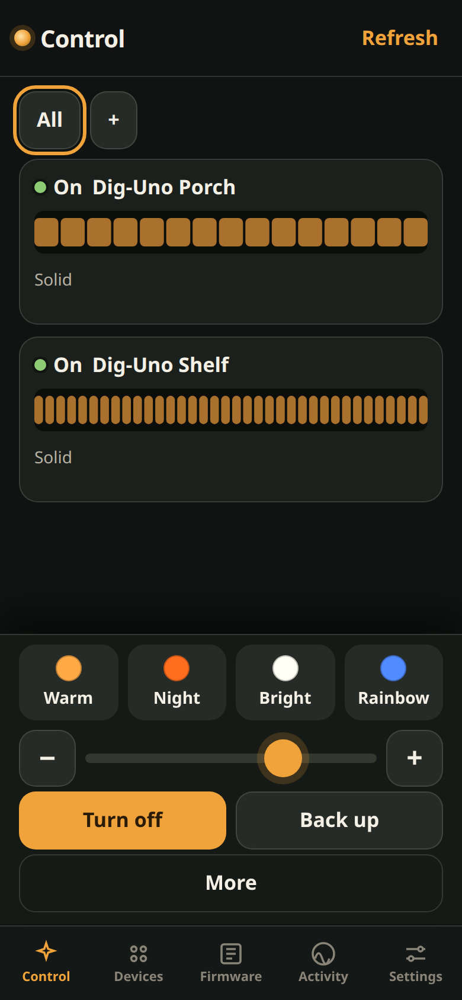
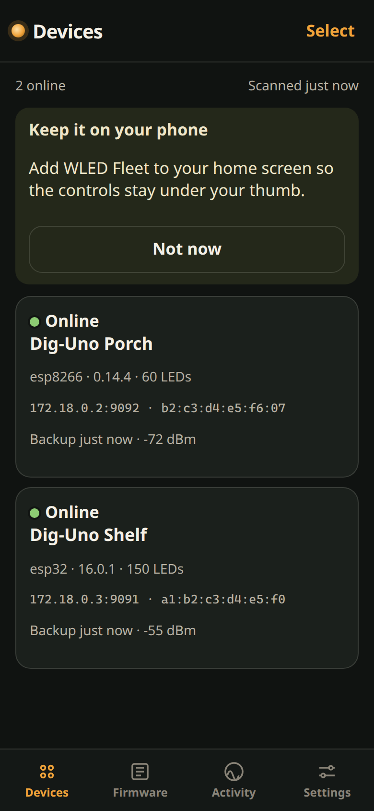
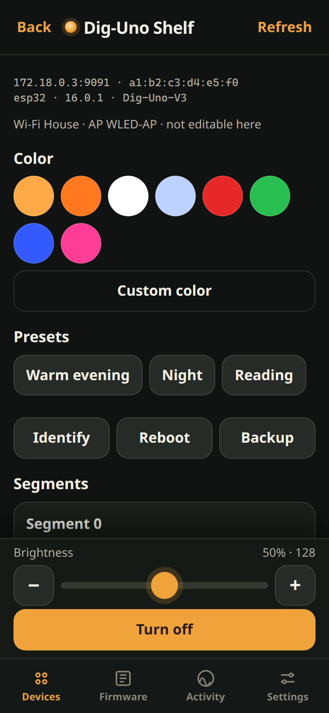

# WLED Fleet

WLED Fleet keeps a house full of [WLED](https://kno.wled.ge) controllers backed up and reachable from a phone. It runs unattended on the LAN, finds controllers by itself, stores their config and presets, and flashes firmware only when you tell it to.

The phone UI is the whole product. Control is the first page: pick a group (or leave it on All) and tap Warm, Night, Bright, or Rainbow to send that look to every board. Turn on, turn off, and Back up are the same kind of single tap. Undo puts the previous look back. Effect, palette, speed, and groups live under More.



## What it does

- Listens for `_wled._tcp` and `_http._tcp`, and sweeps any subnets you configure by requesting `/json/info`. Controllers are tracked by MAC, so a DHCP address change does not create a second device. A controller that already knows its neighbors (`/json/nodes`) is asked for them too.
- Saves `/cfg.json`, `/presets.json`, and `/json/info` as soon as a controller is found, every day after that, and again when the config changes. Identical configs are not stored twice. Old copies are deleted past the retention count.
- Lets you restore a chosen backup (current config is saved first), or download the files as a zip.
- From the phone: on/off, brightness, color, presets, segments, LED lengths, rename, identify, reboot. Wi-Fi and the access point are shown and are not editable.
- Firmware is per device or per profile (Dig-Uno ESP32, Dig-Uno ESP8266, Dig-Quad, generic ESP32, generic ESP8266). You can upload a `.bin` or pull one from the QuinLED or official WLED GitHub releases. The image header and the file name have to match the controller's chip, and a Dig-Uno file will not be offered to a Dig-Quad. A backup runs first. Nothing flashes on a schedule.

## Run the demo

The demo starts the app and two mock controllers (an ESP32 Dig-Uno and an ESP8266 Dig-Uno). No lights required.

```bash
docker compose -f docker-compose.demo.yml up --build
```

Then open [http://127.0.0.1:8787](http://127.0.0.1:8787) on your phone or computer. The shelf controller is probed directly. It tells the app about the porch controller, and both are backed up without any clicks.





Without Docker:

```bash
python -m venv .venv && . .venv/bin/activate
pip install -r requirements.txt
MOCK_PORT=9091 MOCK_PEERS=127.0.0.1:9092 python -m mock.wled_mock &
MOCK_PORT=9092 MOCK_MAC=b2c3d4e5f607 MOCK_NAME="Dig-Uno Porch" \
  MOCK_ARCH=esp8266 MOCK_RELEASE=ESP8266 MOCK_VERSION=0.14.4 MOCK_LEDS=60 \
  MOCK_MDNS_NAME=dig-uno-porch python -m mock.wled_mock &
DATA_DIR=./data EXTRA_HOSTS=127.0.0.1:9091 DISCOVERY_INTERVAL=8 \
  PRESENCE_INTERVAL=5 BACKUP_WATCH_INTERVAL=15 python -m app
```

Tests:

```bash
pip install -r requirements-dev.txt
pytest
```

## TrueNAS SCALE

1. Create a dataset, for example `/mnt/tank/apps/wled-fleet`.
2. Give that dataset to the user the container will run as. The Apps user on SCALE is usually uid `568` and gid `568`. If you set `PUID` and `PGID`, the container starts as root, gives `/data` to that user, then drops privileges.
3. Install a Custom App and paste the compose below, or point the app at `docker-compose.yml` in this repo. `network_mode: host` is what lets the container hear mDNS on the LAN. On SCALE 24.10 and later this is Apps → Discover → Custom App, then the Install via YAML / compose box.
4. Set `DATA_PATH` to the dataset, `TZ` to your timezone, and `ADMIN_PASSWORD` if the NAS is reachable beyond your own Wi-Fi.
5. Publish an image with the GitHub Action in this repo (it builds `linux/amd64` and `linux/arm64` and pushes to GHCR), or build `wled-fleet:local` on a machine that can run `docker compose build`. The first GHCR package is private until you make it public or give the NAS a registry login.
6. Open `http://<truenas-ip>:8787` from a phone on the LAN.

```yaml
services:
  wled-fleet:
    image: ghcr.io/YOUR_USER/wled-fleet:latest
    network_mode: host
    restart: unless-stopped
    environment:
      PORT: "8787"
      TZ: America/New_York
      PUID: "568"
      PGID: "568"
      DATA_DIR: /data
      ADMIN_PASSWORD: ""
      SCAN_SUBNETS: ""
      BACKUP_INTERVAL: "86400"
      BACKUP_WATCH_INTERVAL: "900"
      BACKUP_RETENTION: "30"
    volumes:
      - /mnt/tank/apps/wled-fleet:/data
```

Port `8787` has to be free on the NAS because host networking does not remap ports.

### If the controllers never appear

Host networking is the setup that sees multicast. If the NAS forces bridge networking, mDNS from the LAN usually does not arrive. Two fallbacks:

- Set `SCAN_SUBNETS` to the LAN, for example `192.168.1.0/24`. Sweeps larger than a `/22` are refused. The sweep requests `http://<ip>/json/info` on port 80.
- Set `EXTRA_HOSTS` to one controller you already know (`192.168.1.40` or `192.168.1.40:80`). Fleet also reads `/json/nodes` from every controller it can reach, so one known device often reveals the rest.

`docker-compose.macvlan.yml` is the other option: the container gets its own address on the LAN (change `parent`, subnet, gateway, and `ipv4_address`). A macvlan container cannot talk to the NAS itself. `ipvlan` with `mode: l2` is the same file with the driver name changed, for hosts that block macvlan.

## Phone install

The app is a PWA: manifest, icons, service worker, and `standalone` display. On iPhone, open the site in Safari, tap Share, then Add to Home Screen. It then opens full screen without the browser chrome. That works over plain `http://` on the LAN.

Android's install prompt needs a secure context. For that, generate a certificate once and restart:

```bash
docker exec -it <container> python -m app.mkcert 192.168.1.20
```

Restart the app. It serves HTTPS when `/data/tls/cert.pem` and `key.pem` exist. Trust that certificate on the phone, then use Install. The health check follows whichever scheme is active.

There is no account system. Leave `ADMIN_PASSWORD` empty only when the port is reachable on your own LAN. Set it before any port forward. Backups can contain whatever the controller put in `cfg.json`. Current WLED keeps Wi-Fi passwords in `wsec.json`, which this app does not copy, but treat the dataset as private anyway.

## Firmware

| Board | File to flash |
| --- | --- |
| QuinLED Dig-Uno v3 / v4 (ESP32) | `WLED_*_Dig-Uno*.bin` from [intermittech/QuinLED-Firmware](https://github.com/intermittech/QuinLED-Firmware/releases) |
| Dig-Uno with an AE+ hat, or an Ethernet hat | The matching hat build from that same release. They are not interchangeable. |
| Older Dig-Uno on ESP8266 | Official `WLED_*_ESP8266.bin` from [wled/WLED](https://github.com/wled/WLED/releases) |
| Dig-Quad | The Dig-Quad file, not the Dig-Uno file |
| A generic ESP board | The official WLED build for that exact chip (`ESP32`, `ESP32-S3`, `ESP8266`, …) |

On the Firmware tab, add the Dig-Uno profiles, then either upload a `.bin` or load QuinLED / official WLED releases and tap the asset. The chip is read from the ESP image header (magic `0xE9`, chip id at offset 12 when the header looks like an ESP32 image). A file whose name and header disagree is rejected. Bulk update refuses the whole selection if any chosen controller is a different chip or a different board. A one-device override is not offered in bulk.

OTA has to be unlocked on the controller. If you set a passphrase (the WLED default is often `wledota`) or a settings PIN, save them on that controller's page. They stay in the Fleet database and are not written into the event log.

WLED's own `rel` field is stored when the firmware sends it. Many official builds only say `ESP32`, which does not tell a Dig-Uno from anything else, so the profile is how Fleet knows the board. A top hat (AE+ or Ethernet) still has to be chosen by you; `/json/info` does not report it.

## Environment

| Variable | Default | Meaning |
| --- | --- | --- |
| `PORT` | `8787` | HTTP port |
| `DATA_DIR` | `/data` in Docker, `./data` locally | SQLite database, backup blobs, firmware files |
| `PUID` / `PGID` | `568` | Owner of `/data` when the container starts as root |
| `TZ` | `UTC` | Container clock |
| `ADMIN_PASSWORD` | empty | When set, the API requires a sign-in |
| `SCAN_SUBNETS` | empty | Comma-separated IPv4 networks, each `/22` or smaller |
| `EXTRA_HOSTS` | empty | `host`, `host:port`, or `http://host:port` |
| `DISCOVERY_INTERVAL` | `60` | Seconds between full scans (mDNS is continuous) |
| `PRESENCE_INTERVAL` | `20` | Seconds between online checks of known controllers |
| `BACKUP_INTERVAL` | `86400` | Scheduled backup period, in seconds |
| `BACKUP_WATCH_INTERVAL` | `900` | How often configs are compared for changes |
| `BACKUP_RETENTION` | `30` | Versions kept per controller |
| `SCAN_CONCURRENCY` / `SCAN_TIMEOUT` | `48` / `1.2` | Sweep parallelism and per-host timeout |
| `WLED_GITHUB_REPO` | `wled/WLED` | Official release source |
| `QUINLED_GITHUB_REPO` | `intermittech/QuinLED-Firmware` | QuinLED board builds |
| `OTA_TIMEOUT` | `180` | Seconds allowed for one flash, including the reboot |
| `SCHEDULER_ENABLED` | `true` | Set `0` to run the API without background discovery |

The same values can be changed under Settings. A saved value wins over the environment until you choose "Use environment defaults".

Data layout inside the volume:

```
fleet.db          SQLite (devices, backup index, profiles, events)
blobs/            content-addressed cfg, presets, and info files
firmware/         uploaded and downloaded .bin files, named by sha256
session.key       cookie signing key
tls/              optional cert.pem and key.pem
```

## Development

Python 3.12, FastAPI, and SQLite. The UI is one stylesheet and one script, cached by the service worker with network-first so a phone on LAN Wi-Fi still opens if the last copy is already on the device.

Discovery parsing, backup dedupe, and firmware compatibility are covered by `pytest`. `tests/test_flow.py` boots the mock controller, discovers it (including the neighbor it advertises), backs it up, renames it, changes color and LED count, refuses an ESP8266 image on the ESP32 mock, and flashes a matching image.
